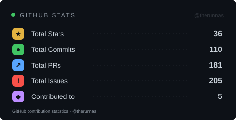
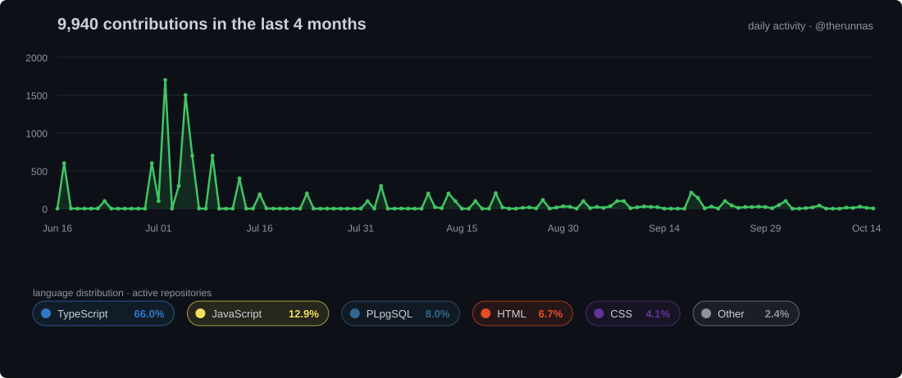
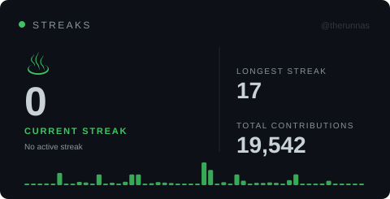
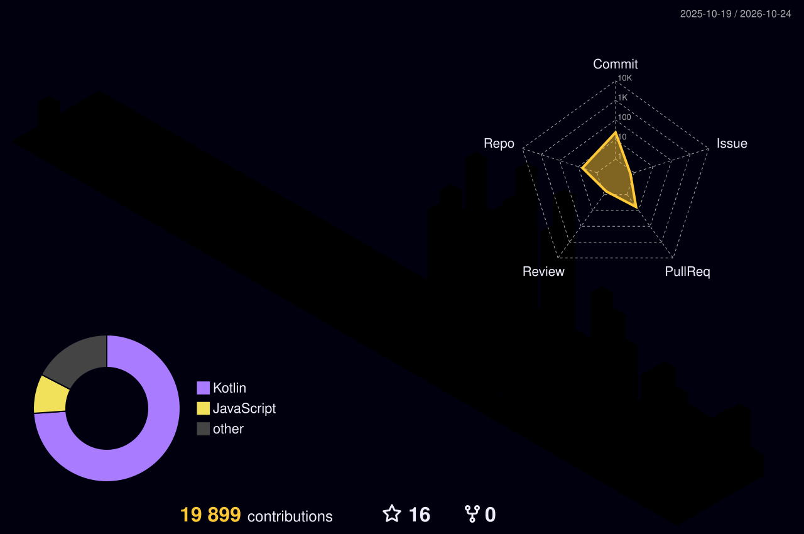

 

**Full-stack developer building internal systems and automation. Next.js, TypeScript, Prisma and PostgreSQL, with care for access control, audit and data integrity.**

Goal: complex systems that solve real-world problems.

 

<picture>
  <source media="(max-width: 700px)" srcset="assets/papeis-celular.svg" />
  
</picture>

 

 

## 💼 Selected work

Project names and details are kept generic.

 

<picture>
  <source media="(max-width: 700px)" srcset="assets/cases-celular.svg" />
  
</picture>

<b>📖 What each project is and my role</b>

 

**🗓️ Operations panel**
- **Solution:** web panel to manage staff, operations, time records, billing and reports, with role-based access, two-factor authentication and an audit trail of changes.
- **My role:** full-stack development.

**📊 Finance & ops**
- **Solution:** web system for financial and operational control: jobs, income and expenses, cash flow, budgets and proposals, with staged data imports, an audit log and invitation-based access.
- **My role:** full-stack development.

**🧭 Dev control plane**
- **Solution:** command-line tooling and documentation that keep shared agent skills and project conventions consistent across multiple repositories.
- **My role:** design and development of the tooling.

**💬 Community bot**
- **Solution:** modular Discord bot that posts configurable welcome and leave messages, with an optional generated image card. Structured to grow with new modules.
- **My role:** full-stack development.

Sources: each project's repository documentation and code. No business results are claimed.

 

## 🛠️ Stack

 

 

## 🧠 How I work

**Principles I apply, project by project:**

<picture>
  <source media="(max-width: 700px)" srcset="assets/principios-celular.svg" />
  
</picture>

 

<!-- github:start -->

## 📊 GitHub activity

Generated daily by GitHub Actions from the GitHub API. Public, itemized activity only, unless noted.

 

<picture>
  <source media="(max-width: 700px)" srcset="assets/cards/stats-mobile.svg" />
  
</picture>

 

<picture>
  <source media="(max-width: 700px)" srcset="assets/cards/activity-graph-mobile.svg" />
  
</picture>

 

<picture>
  <source media="(max-width: 700px)" srcset="assets/cards/streak-mobile.svg" />
  
</picture>

 

<picture>
  <source media="(prefers-color-scheme: dark)" srcset="https://raw.githubusercontent.com/therunnas/Therunnas/output/pacman-contribution-graph-dark.svg" />
  
</picture>

 

Pac-Man and the 3D calendar draw GitHub's contribution calendar as GitHub reports it: public and private, including automated activity, so their totals are not a measure of manual work. The 3D language donut uses the same code-size source as the activity graph.

<!-- github:end -->

 

